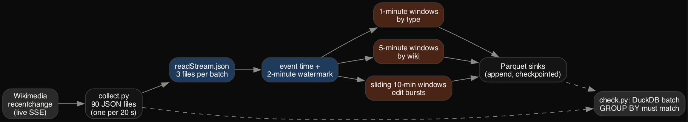
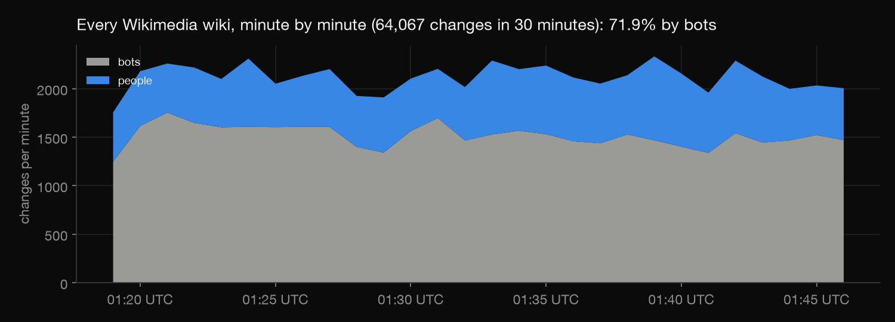
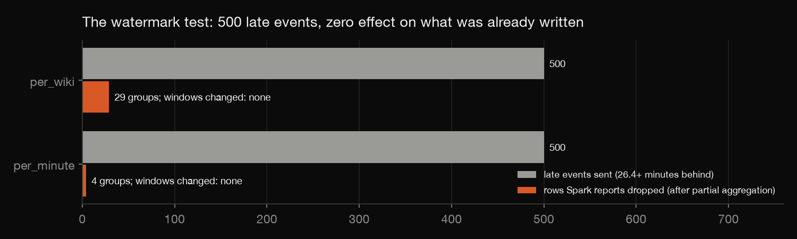

# Live Wikipedia edits in Spark Structured Streaming

Every edit on every Wikimedia wiki is published live as a stream of events. This project records 30 minutes of that
stream, then processes it with Spark Structured Streaming, the way a real-time pipeline would:
- event time, a watermark, and windowed aggregations;
- checkpointed Parquet sinks.

It then proves the streaming answers are right twice: by recomputing them in one batch query, and by deliberately
sending late data to see what the watermark does.

Build log: https://mrrishit909.github.io/projects/wiki-stream-spark/

## Data

Wikimedia EventStreams `recentchange` (`stream.wikimedia.org/v2/stream/recentchange`), 01:19–01:49 UTC on 2 October
2026: 64,067 changes on 145 wikis. `collect.py` writes a new file every 20 seconds (write then rename, so Spark never
reads half a file). User names are dropped at collection; distinct editors are counted from a short hash. The raw
files are not committed.

## Steps

| Step | File | What it does |
|---|---|---|
| 1 | `collect.py` | record the live stream into 90 small files |
| 2 | `stream.py` | Spark Structured Streaming: 3 files per micro-batch, 2-minute watermark, three windowed queries, Parquet sinks, `trigger(availableNow)` |
| 3 | `check.py` | every written window recomputed in one DuckDB batch query |
| 4 | `late_test.py` | send 500 events 26+ minutes late and compare |
| 5 | `summarize.py` | the stream's story |
| 6 | `charts.py` | charts |

## The three streaming queries

| Query | Windows | Output |
|---|---|---|
| per_minute | tumbling 1 minute, by change type | changes, bots, anonymous editors, reverts |
| per_wiki | tumbling 5 minutes, by wiki | changes |
| bursts | sliding 10 minutes every 5 | pages with 5+ human edits from 3+ editors (approximate distinct count) |

All three run in append mode: a window is written once, after the watermark (latest event time minus 2 minutes) passes
its end. The whole recording replays in 31 micro-batches in about 17 seconds.

## What the stream showed

- **Bots:** 71.9% of all changes, and 98–100% on Russian Wikipedia, Russian Wikiquote, Chinese Wikisource and Chechen
  Wikipedia.
- **The mix:** 24,763 edits, 1,655 new pages, 25,823 category changes and 11,826 log events.
- **Busiest wikis:** Wikimedia Commons and Wikidata, then Chinese Wikisource, Russian and English Wikipedia.
- **People:** 1.4% of changes came from anonymous or temporary accounts, and 0.16% mention a revert.
- **Edit bursts are rare.** In 30 minutes one page met the burst rule, a user talk page whose title is not published.
  The busiest pages were one person saving again and again, not several people disagreeing.

## Two checks

**1. Batch equals stream.** `check.py` recomputes every written window with one DuckDB query over the same files. All
112 per-minute and 465 per-wiki windows match exactly, and every window that had closed was written. The burst's
editor count comes from a HyperLogLog sketch, so it is compared with the exact count to within 10%.

**2. The watermark under stress.** The recorded stream arrived in order: no event was ever behind the newest one
already delivered (`results/lateness.csv`), so the watermark never had to act. `late_test.py` adds one more file of 500
events from early in the recording, at least 26.4 minutes behind, as a lagging source would send them. Result:
- every window written is identical to the normal run;
- Spark reports 4 and 29 dropped rows, not 500. Its `numRowsDroppedByWatermark` counts rows after the partial
  aggregation, so the 500 late events had already been folded into 4 (minute, type) and 29 (5-minute, wiki) groups.
  The test checks those counts exactly.

## Not done

- A replay of a recording, not a 24/7 deployment; no Kafka, no cluster.
- 30 minutes is too short to find real edit wars.
- Append mode only; update mode, or a longer watermark for late-arriving sources, are not compared.
